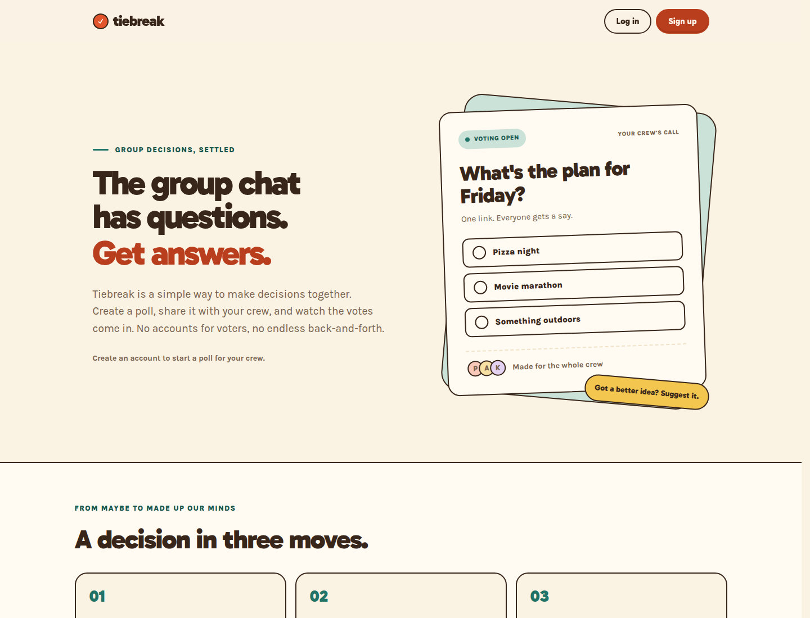

# Tiebreak

Tiebreak helps a group make a decision in its chat. A creator makes a poll and shares one link; friends vote without accounts, can suggest choices, and see the result when voting closes.

**Challenge:** [Frontend Mentor Product Challenge: Poll Creator App](https://www.frontendmentor.io/challenges/poll-creator-app)

**Live site:** [tiebreak.elhuzain.com](https://tiebreak.elhuzain.com)



## Built with

- Next.js 16 and React 19
- TypeScript
- Supabase Auth, Postgres, and `@supabase/ssr`
- Tailwind CSS 4 and CSS custom properties
- DiceBear Micah avatars

## Local setup

Run `npm install`, then set these values in `.env.local` from your Supabase project's Connect panel:

```env
NEXT_PUBLIC_SUPABASE_URL=...
NEXT_PUBLIC_SUPABASE_PUBLISHABLE_KEY=...
```

Run `npm run dev` and open `http://localhost:3000`.

The creator auth flow uses Supabase Auth with email and password. User sessions live in cookies via `@supabase/ssr`; the Next.js Proxy refreshes them, and the dashboard checks the authenticated user on the server. The publishable key is used for session-scoped auth requests. Backend poll data access uses the server-only `SUPABASE_SECRET_KEY` after verifying the creator; it is never used for login or signup.

## Email confirmation setup

Hosted Supabase projects usually require email confirmation. In **Authentication → URL Configuration**, set the Site URL to your app's origin and add `http://localhost:3000/auth/callback` to the Redirect URLs for local development. Add your deployed callback URL when deploying.

In **Authentication → Email Templates → Confirm signup**, make the confirmation link point to the callback with a token hash. The signup action passes `/auth/callback` as `RedirectTo`, so use:

```html
<a href="{{ .RedirectTo }}?token_hash={{ .TokenHash }}&type=email">Confirm your email</a>
```

The callback verifies the token, stores the session in cookies, and redirects to `/dashboard`. If email confirmation is disabled, signup receives a session immediately and redirects there directly. [Supabase's SSR email-confirmation guide](https://supabase.com/docs/guides/getting-started/tutorials/with-nextjs) explains the token-hash requirement.

## Poll creation

The dashboard has a **Create poll** button. The form saves a question, 2–10 options, a closing time, a choice limit, and the suggestions setting through the backend admin client. After creation, the poll appears in **My polls**.

Apply the initial schema in `lib/supabase/migrations/20260915000000_initial_schema.sql` to a fresh project. The backend verifies the creator using the cookie-scoped auth client, writes the poll and its options with the admin client, and removes the poll if option insertion fails.

Apply `lib/supabase/migrations/20260915000001_poll_slugs.sql` after the initial schema. It backfills existing polls, requires a slug for every poll, and enforces uniqueness. New slugs are random and the backend retries if a collision reaches the unique constraint. Poll cards copy a URL at `/poll/<slug>`. The unguessable slug is the access-by-link identifier, so never expose a public poll-list endpoint.

## Voter and creator poll views

The public `/poll/<slug>` page lets a voter pick a name, one of four DiceBear Micah avatars, and one or more options up to the poll's limit. Voting has a confirmation step because ballots are final. If suggestions are enabled, a voter can send an option for creator approval; pending suggestions never appear on the public ballot. After a vote, live totals appear and update every five seconds. Open-poll results expose counts but not who chose each option.

A random token is stored per poll in browser session storage. The server stores only its SHA-256 hash and the `(poll_id, voter_token_hash)` unique key prevents the same token casting twice. A pending token is saved before submission so a network retry uses the same identity; it becomes a voted token only after the server confirms the ballot. This is casual prevention: another browser or a new session can vote again.

The creator opens a poll from My polls to see the race, recent voter avatars, pending suggestions, and the share link. Open polls refresh every five seconds. Declining a suggestion keeps an Undo path. Ending voting settles the poll; reopening requires confirmation and a new future deadline, while prior votes stay final. When a closing time passes, the creator view settles the poll on read; public views treat it as closed immediately.

## What I learned

- With no Figma file, I treated the brand kit and product requirements as constraints, then designed the missing voter, first-run, and reveal states around the actual group-chat workflow. Keeping counts beside percentages and showing who backed each option after closing helped the results stay legible and honest.
- Supabase SSR taught me to keep browser auth and privileged data access separate. The cookie-scoped client verifies the creator, while the server-only admin key performs poll writes; the Next.js Proxy refreshes the session so server-rendered dashboard requests see the current user.
- Five-second polling was a straightforward way to keep creator and voter results fresh without adding realtime infrastructure. It also made the trade-off clear: updates are not instant, and periodic refreshes need cleanup and clear closed-poll behavior.

## Continued development

- Add focused tests for poll transitions, duplicate ballot submissions, and suggestion moderation so the server remains the source of truth for each state.
- Revisit live updates if the product needs lower latency; Supabase Realtime could replace periodic refreshes, with polling retained as a fallback.
- Do a full keyboard and screen-reader pass on the voter confirmation, moderation actions, and results updates, then address any gaps found.

## Useful resources

- [Next.js documentation](https://nextjs.org/docs)
- [Supabase: Use Supabase with Next.js](https://supabase.com/docs/guides/getting-started/tutorials/with-nextjs)
- [Supabase SSR package](https://supabase.com/docs/guides/auth/server-side/creating-a-client)
- [DiceBear documentation](https://www.dicebear.com/how-to-use/http-api/)
